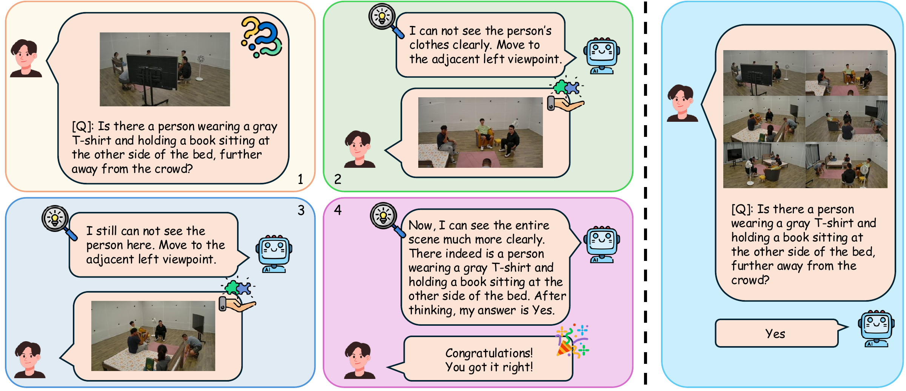

<div align="center">

# **Humans in Space: Can MLLMs Construct Human-Centric Spatial Understanding via Active Exocentric Exploration?**

***Accepted to WACV 2027***

[](https://gtc-gh.github.io/SATE-Bench/)
[](#)
[](https://huggingface.co/datasets/gtc-hf/SATE-Bench)
[](https://github.com/gtc-gh/SATE-Bench)

</div>

<p align="center">
  
</p>

<p align="center">
  <sub><b>Left (Active setting):</b> starting from a single occluded view, the model must recognize what it cannot see and move to adjacent viewpoints until it has enough evidence to answer. <b>Right (Passive setting):</b> the model receives a bag of views that already contains the answer.</sub>
</p>

<p align="center">
  <i>SATE-Bench is an interactive benchmark of 2,525 multi-turn QA pairs over 316 real-world, human-centric multi-view scenes. It evaluates whether MLLMs know <b>when to explore</b> and <b>when they have seen enough</b>: an occluded initial view leaves the model "hungry" for information, and it has to explore the scene to fully "sate" that need.</i>
</p>

<p align="center">
  ⭐ <b>Please give a star if you find this project helpful or use it in your research!</b>
</p>

---

This is the official repository for the paper **"Humans in Space: Can MLLMs Construct Human-Centric Spatial Understanding via Active Exocentric Exploration?"** (WACV 2027). It contains the SATE-Bench annotations, data preparation scripts, the MLLMs evaluation code, and the GRPO training code.

---

## 📰 News

* **`[2026/10]`**: 🎉 **Our paper has been accepted to WACV 2027!**

---

## 🔍 Key Findings

* **Passive–Active Gap**: Models that fuse static multi-view inputs well fail when they must collect the views themselves. Gemini-3.5-flash reaches 69.2% accuracy in the Passive setting but only 56.8% in the Active setting.
* **Premature Spatial Termination**: MLLMs underestimate their own visual uncertainty. Humans move to a new viewpoint in 88.1% of the questions (4.7 steps on average), while the best model averages only 2.5 steps, and models report high confidence even when they stop too early.
* **Breakdown on Spatial Geometry**: Entity queries are handled reasonably well, but accuracy collapses on tasks that need precise 3D alignment, e.g. Human-Object Interaction (31.9%) and View-Specific Depth Ordering (32.2%) for Gemini-3.5-flash.
* **Open-Source Models Rarely Explore**: Open-source models almost always answer from the initial occluded view (e.g. Qwen2.5-VL-3B-Instruct explores in 0.2% of the questions).
* **RL Elicits Exploration, With a Trade-off**: GRPO fine-tuning raises the active exploration rate of Qwen2.5-VL-3B from 0.2% to up to 72.8%, while Passive accuracy stays stable (~51%). Stronger exploration rewards, however, lower Active accuracy, exposing a bottleneck in dynamic multi-view fusion.

---

## 📖 Active vs. Passive Evaluation

SATE-Bench evaluates every model in two complementary settings:

1. **Active Setting (multi-turn view exploration)**: The model receives one initial view in which the key evidence is occluded or out of sight. At every turn it either answers the question or moves to the adjacent left (clockwise) or right (counter-clockwise) viewpoint, keeping the full interaction history. Exploration efficiency is measured with a step-penalized reward.
2. **Passive Setting (single-turn bag of frames)**: The model receives an annotated subset of views that is guaranteed to contain all the evidence. This isolates pure multi-view fusion from exploration.

In total, SATE-Bench contains 2525 questions. Each question has 5 options (including one abstention option, e.g. "the target is not visible") or 2 options (Yes/No existence questions).

---

<a id="project-directory-structure"></a>

## 🗂️ Project Directory Structure

```
SATE-Bench/
├── asset/                         # README figure (sate_teaser.png)
├── configs/
│   └── models/                    # One config per evaluated model (backend + inference settings)
├── data/
│   ├── README.md                  # Hugging Face dataset card
│   ├── benchmark/
│   │   ├── spatial_active.json    # 1,615 Active-setting QA pairs
│   │   ├── spatial_passive.json   # 910 Passive-setting QA pairs
│   │   ├── metadata.jsonl         # Questions + image lists for the Hugging Face Dataset Viewer
│   │   └── images/                # Multi-view frames (downloaded from Hugging Face / extracted for Ego-Exo4D)
│   └── train/
│       ├── train.json             # 17,433 GRPO training samples
│       ├── val.json               # 1,937 GRPO validation samples
│       └── images/                # Training frames (M3GYM + Ego-Exo4D)
├── data_preparation/
│   └── egoexo4d/
│       ├── download_command.py    # Prints the egoexo command for the 93 takes SATE-Bench needs
│       ├── extract_frames.py      # Rebuilds the Ego-Exo4D frames from the official videos
│       ├── benchmark_frames.json  # Exact frame locations of the 161 benchmark frames
│       └── train_frames.json      # Exact frame locations of the 708 training frames
├── sate_bench/                    # Shared library
│   ├── config.py                  # Paths, evaluation constants (max turns, lambda, resolution)
│   ├── prompts.py                 # Evaluation prompts (Active and Passive settings)
│   ├── models.py                  # Gemini / OpenAI / vLLM backends
│   ├── parsing.py                 # Rule-based answer parsing + LLM fallback extractor
│   ├── data.py                    # Annotation and image loading
│   └── metrics.py                 # Accuracy, steps, reward, active rate; resumable result logging
├── evaluation/
│   ├── run_active.py              # Active setting (API and vLLM models)
│   ├── run_passive.py             # Passive setting (API and vLLM models)
│   ├── run_active_grpo.py         # Active setting for GRPO fine-tuned checkpoints
│   └── summarize.py               # Collects all metrics into one table
├── training/
│   ├── config.yaml                # GRPO hyper-parameters (Table 20 of the paper)
│   ├── train_grpo.py              # GRPO training with TRL + vLLM rollouts
│   ├── rewards.py                 # Accuracy / format / action rewards
│   ├── prompts.py                 # Training prompt template
│   └── train.sh                   # Single- / multi-GPU launcher
├── scripts/
│   ├── download_data.py           # Downloads the images from Hugging Face
│   ├── build_viewer_metadata.py   # Regenerates data/benchmark/metadata.jsonl for the Dataset Viewer
│   ├── eval_api_models.sh         # Gemini and GPT models of the paper
│   ├── eval_open_source.sh        # Open-source models of the paper
│   └── eval_grpo.sh               # Active + Passive evaluation of a GRPO checkpoint
├── .env.example                   # Template for API keys
├── requirements.txt               # Pip dependencies
├── LICENSE                        # Apache License 2.0 (code)
├── NOTICE                         # Copyright notice
└── README.md                      # This README file
```

---

## 📝 Annotation Data Structure

The benchmark annotations are stored in `data/benchmark/spatial_active.json` and `data/benchmark/spatial_passive.json`. Each entry is one multiple-choice question. Here is an example of an Active-setting entry:

```json
{
  "index": 0,
  "dataset": "Ego-Exo4D",
  "scene": "cmu_soccer06_5/0",
  "type": "active",
  "question_name": "Human Counting",
  "question": "Based on all the provided views, how many unique people can be identified in the entire indoor training facility?",
  "options": {
    "A": "6",
    "B": "9",
    "C": "The queried entity does not exist or is not visible, or the provided images are insufficient to answer the question.",
    "D": "8",
    "E": "7"
  },
  "answer": "E",
  "num_views": 4,
  "image_paths": [
    "images/Ego-Exo4D/cmu_soccer06_5/0/view_1.jpg",
    "images/Ego-Exo4D/cmu_soccer06_5/0/view_2.jpg",
    "images/Ego-Exo4D/cmu_soccer06_5/0/view_3.jpg",
    "images/Ego-Exo4D/cmu_soccer06_5/0/view_4.jpg"
  ],
  "active_init_view": 4
}
```

### Attribute Descriptions

* **`index`**: `(int)` Unique identifier of the question within its annotation file.
* **`dataset`**: `(str)` Source dataset of the scene (e.g., `Harmony4D`, `Ego-Exo4D`).
* **`scene`**: `(str)` Sequence name and synchronized frame index (`<sequence>/<frame>`).
* **`type`**: `(str)` Evaluation setting (`active` or `passive`).
* **`question_name`**: `(str)` Task name (one of the ten tasks listed in `sate_bench/config.py`, e.g. `Human Counting`).
* **`question`**: `(str)` The natural-language question.
* **`options`**: `(dict)` Answer options `A`–`E` (or `A`–`B` for 2-option questions).
* **`answer`**: `(str)` The ground-truth option letter.
* **`num_views`**: `(int)` Number of available camera views of the scene (4–8).
* **`image_paths`**: `(list[str])` All views of the scene, relative to `data/benchmark/`. Views are ordered clockwise around the scene (`view_1`, `view_2`, ...), so moving "left" goes from `view_k` to `view_{k+1}`.
* **`active_init_view`**: `(int, Active only)` 1-based index of the initial, occluded view.
* **`passive_views`**: `(list[int], Passive only)` 1-based indices of the views given to the model in the Passive setting.

The GRPO training files (`data/train/train.json`, `data/train/val.json`) use single-view samples with the fields `index`, `dataset`, `type`, `question_name`, `question`, `options`, `answer` and `image_path` (relative to `data/train/`). For `active` training samples, the correct option is *"Move and explore more views."*

---

## 🚀 Getting Started

### 1. Installation

First, clone the repository and create an environment:

```bash
git clone https://github.com/gtc-gh/SATE-Bench.git
cd SATE-Bench
conda create -n sate python=3.12 -y
conda activate sate
pip install -r requirements.txt
```

The code is tested with Python 3.12, PyTorch 2.11, vLLM 0.25, Transformers 5.13 and TRL 1.10. Open-source models are served with [vLLM](https://github.com/vllm-project/vllm); please refer to the official vLLM installation guide if your CUDA version differs.

> [!NOTE]
> If multi-GPU inference with vLLM (tensor parallelism, `--tensor_parallel_size` ≥ 2) is not supported by your GPUs or raises errors, you can run the open-source models with [Hugging Face Transformers](https://github.com/huggingface/transformers) instead. This repository only includes vLLM, Gemini and OpenAI backends, so you need to add a Transformers backend to `sate_bench/models.py` yourself.

### 2. API Keys

API keys are read from environment variables only (see `.env.example`):

```bash
export GEMINI_API_KEY=YOUR_GEMINI_API_KEY   # Gemini models + answer-extraction fallback
export OPENAI_API_KEY=YOUR_OPENAI_API_KEY   # GPT models
```

> [!NOTE]
> A small model (`gemini-2.5-flash-lite`) is used as a fallback to extract the chosen letter when rule-based parsing fails. It is optional for open-source models: without `GEMINI_API_KEY`, unparsable outputs are counted as invalid answers. In our experiments the fallback is rarely triggered, so its cost is negligible.

### 3. Dataset Preparation

1. Download the multi-view images of all source datasets except Ego-Exo4D from [Hugging Face](https://huggingface.co/datasets/gtc-hf/SATE-Bench).
   ```bash
   python scripts/download_data.py                     # benchmark + training images
   python scripts/download_data.py --subset benchmark  # evaluation images only
   ```
   The Hugging Face dataset requires an access request: request access on the dataset page and log in with `hf auth login` before downloading.
2. **Ego-Exo4D frames are not redistributed.** Request access by signing the Ego-Exo4D license at <https://ego4d.dev/request/ego-exo4d>. After about 48 hours you receive AWS credentials by email (valid for 14 days). Then install the downloader and set up the credentials:
   ```bash
   pip install ego4d awscli
   aws configure   # access key and secret key from the email
   ```
3. Download the Ego-Exo4D metadata, then only the 448p videos of the 93 takes used by SATE-Bench (instead of the ~14 TiB default download). The helper prints the `egoexo` command with the required take UIDs:
   ```bash
   egoexo -o <EGOEXO_DIR> --parts metadata
   python data_preparation/egoexo4d/download_command.py --takes_json <EGOEXO_DIR>/takes.json
   # run the printed command: egoexo -o <EGOEXO_DIR> --parts downscaled_takes/448 --uids ...
   ```
4. Rebuild the exact Ego-Exo4D frames used by SATE-Bench (161 benchmark frames from 38 takes and 708 training frames from 55 takes):
   ```bash
   python data_preparation/egoexo4d/extract_frames.py --egoexo_root <EGOEXO_DIR>
   # evaluation frames only:
   python data_preparation/egoexo4d/extract_frames.py --egoexo_root <EGOEXO_DIR> --split benchmark
   ```
5. Ensure the directories align with the [Project Directory Structure](#project-directory-structure) shown above. The evaluation scripts check that every image exists before running.

All benchmark frames come from the official test splits (or held-out subsets) of the source datasets. The GRPO training frames come from disjoint training sequences of M3GYM (31 sequences) and Ego-Exo4D (55 takes).

---

## 🧪 Running Evaluations

All scripts write `predictions.csv` (one row per turn) and `metrics.json` to `results/<setting>/<config_name>/`. Every view is resized to 1280×720, and all models are decoded greedily (temperature 0) except the GPT-5 models, which only support their default temperature. Add `--limit N` for a quick test on the first `N` questions.

### 1. Model Configs

Every model has a config file in `configs/models/` with its backend and the inference settings used in the paper. Settings that differ between the two evaluation settings go under `active:` and `passive:`:

```yaml
# configs/models/qwen3-vl-8b-instruct.yaml
backend: vllm
model: Qwen/Qwen3-VL-8B-Instruct
gpu_memory_utilization: 0.8
max_model_len: 16384
max_tokens: 8192
repetition_penalty: 1.05

active:
  enable_thinking: true
passive:
  enable_thinking: false
```

| Config | Model | Backend |
|---|---|---|
| `gemini-3.5-flash`, `gemini-3.1-flash-lite`, `gemini-2.5-flash`, `gemini-2.5-flash-lite` | Gemini | Gemini API |
| `gpt-5.2`, `gpt-5-mini`, `gpt-5-nano` | GPT-5 | OpenAI API |
| `qwen2.5-vl-3b-instruct`, `qwen3-vl-8b-instruct`, `qwen3-vl-8b-thinking` | Qwen-VL | vLLM |
| `gemma-3-4b-it` | Gemma-3 | vLLM |
| `llava-onevision-2-8b` | LLaVA-OneVision | vLLM |
| `grpo-qwen2.5-vl-3b` | GRPO checkpoint (Passive setting) | vLLM + LoRA |

Command-line options override the values in a config (e.g. `--tensor_parallel_size 2`, `--gpu_memory_utilization 0.7`). To evaluate another model, copy a config and change `model`.

### 2. Proprietary & API-based Models

```bash
python evaluation/run_active.py  --config configs/models/gemini-3.1-flash-lite.yaml
python evaluation/run_passive.py --config configs/models/gemini-3.1-flash-lite.yaml

python evaluation/run_active.py  --config configs/models/gpt-5-mini.yaml
python evaluation/run_passive.py --config configs/models/gpt-5-mini.yaml
```

`bash scripts/eval_api_models.sh` runs all proprietary models of the paper.

### 3. Local Open-Source Models (vLLM)

```bash
python evaluation/run_active.py  --config configs/models/qwen3-vl-8b-instruct.yaml
python evaluation/run_passive.py --config configs/models/qwen3-vl-8b-instruct.yaml
```

`bash scripts/eval_open_source.sh` runs all open-source models of the paper (Qwen2.5-VL, Qwen3-VL Instruct and Thinking, Gemma-3 and LLaVA-OneVision).

> [!IMPORTANT]
> **Gemma-3** is a gated model. Before the first run, request access on its [Hugging Face model page](https://huggingface.co/google/gemma-3-4b-it) (accept the license) and log in with `hf auth login`.

### 4. Summarizing Results

```bash
python evaluation/summarize.py
```

This prints all finished runs as a table in the layout of Table 4 (per-task accuracy, Avg. Acc, Avg. Steps, Avg. Reward, Active Rate).

---

## 🏋️ GRPO Training

We explore whether active exploration can be learned with Group Relative Policy Optimization. `Qwen/Qwen2.5-VL-3B-Instruct` is fine-tuned with LoRA on a balanced 1:1 mixture of Active and Passive single-view samples (19,370 QA pairs synthesized from 86 training scenes of M3GYM and Ego-Exo4D). The model reasons inside `<think>...</think>` and answers with `\boxed{LETTER}`, choosing either a factual option or *"Move and explore more views."*

1. **Prepare the training images**:
   ```bash
   python scripts/download_data.py --subset train
   python data_preparation/egoexo4d/extract_frames.py --egoexo_root <EGOEXO_DIR> --split train
   ```
2. **Train** (all hyper-parameters are in `training/config.yaml` and can be overridden on the command line):
   ```bash
   bash training/train.sh
   CUDA_VISIBLE_DEVICES=0,1,2,3 bash training/train.sh --action_weight 1.2 --output_dir checkpoints/grpo_action1.2
   ```
3. **Evaluate** a checkpoint in both settings:
   ```bash
   bash scripts/eval_grpo.sh checkpoints/grpo_qwen25vl_3b
   ```

The reward of a sampled completion combines an accuracy term ($r_1 = 1.0$), a format term ($r_2 = 0.5$) and an action term ($r_3$, swept over $[0.05, 1.4]$ in the paper) that rewards choosing to explore (see `training/rewards.py`).

---

## 📈 Evaluation Metrics

* **Accuracy (Avg. Acc)**: Exact-match accuracy of the final predicted option over all questions, independent of the exploration trajectory.
* **Average Steps (Avg. Steps)**: Average number of views observed before the final decision (Active setting).
* **Active Rate**: Fraction of questions in which the model moves to at least one new viewpoint instead of answering from the initial view, averaged over the ten tasks.
* **Exploration Efficiency Reward (Avg. Reward)**: For a task with $N$ questions, where the model answers question $i$ after $s_i$ steps, the reward is

$$
R = \frac{1}{N} \sum_{i=1}^{N} \mathbb{I}(c_i) \cdot e^{-\lambda \cdot s_i},
$$

where $\mathbb{I}(c_i)$ is 1 if the final answer is correct and $\lambda = 0.1$. The reported Avg. Reward is the mean of $R$ over the ten tasks. *A higher reward means correct answers reached with fewer, more deliberate exploration steps.*

In the Active setting, an episode ends when the model answers, outputs an invalid action, or has observed `--max_turns` views (default: 8, the same for API and open-source models). `metrics.json` additionally reports the reward and active rate averaged over all questions (`*_sample_mean`) and every metric per task (`per_task`).

---

## 💻 System Requirements & Performance

### GPU Requirements
* **Open-source models**: Smaller models (e.g., Qwen2.5-VL-3B, Gemma-3-4B) run on RTX 3090 GPUs (24 GB); larger models were evaluated on a single H100. Use `--tensor_parallel_size` to split a model across several GPUs.
* **GRPO training**: A single node with 4× H100 GPUs; a training run typically finishes within a few hours. Training also runs on 2 GPUs, but takes longer.

### Time & Cost Estimates
* **Local inference time**: Most open-source models finish each setting in under three hours on one GPU. Reasoning models are much slower in the Active setting (Qwen3-VL-8B-Thinking takes more than 20 hours).
* **Proprietary API time**: The Active setting is multi-turn and therefore slower than the Passive setting (e.g., 9.4 h vs. 2.8 h for Gemini-3.5-flash).
* **Proprietary API cost**: The Active setting exceeds **$150 USD** for the largest proprietary models, while smaller models and the Passive setting generally cost **under $50 USD**.

All evaluation scripts save results incrementally and resume automatically when they are re-run.

---

## 🎓 Citation

If you use SATE-Bench in your research, please cite our WACV 2027 paper:

```bibtex

```

---

## 🤝 Acknowledgements

We express our sincere gratitude to the authors and institutions who collected and open-sourced the original datasets that form the bedrock of SATE-Bench:
* **[4D-OR](https://github.com/egeozsoy/4D-OR)**: A multi-view operating room dataset for semantic scene graph generation.
* **[core4D](https://github.com/leolyliu/CORE4D-Instructions)**: A 4D human-object-human interaction dataset for collaborative object rearrangement.
* **[Ego-Exo4D](https://ego-exo4d-data.org/)**: A large-scale dataset of skilled human activities from egocentric and exocentric perspectives.
* **[EgoHumans](https://rawalkhirodkar.github.io/egohumans/)**: An egocentric and exocentric 3D multi-human benchmark.
* **[Harmony4D](https://jyuntins.github.io/harmony4d/)**: A multi-view video dataset of in-the-wild close human interactions.
* **[HOI-M3](https://juzezhang.github.io/HOIM3_ProjectPage/)**: A dense multi-person human-object interaction dataset.
* **[M3GYM](https://finalyou.github.io/M3GYM/)**: A multi-view, multi-person gym and fitness activity dataset.
* **[MM-OR](https://github.com/egeozsoy/MM-OR)**: A multi-modal operating room dataset.
* **[MvMHAT](https://github.com/realgump/MvMHAT)**: A multi-view multi-person tracking dataset.
* **[Replay](https://github.com/facebookresearch/replay_dataset)**: A multi-view, multi-modal video dataset of human social interactions.

---

## 📄 License

* **Code**: released under the [Apache License 2.0](LICENSE). Copyright 2026 Tianchen Guo (see [NOTICE](NOTICE)).
* **Annotations and data** (questions, options, answers, view selections, and the released frames): [CC BY-NC 4.0](https://creativecommons.org/licenses/by-nc/4.0/), for non-commercial use only.
* **Images**: frames derived from the source datasets additionally remain subject to the original licenses and terms of use of each dataset.

SATE-Bench must not be used for person re-identification, surveillance, or any other application that violates the terms of the source datasets.
